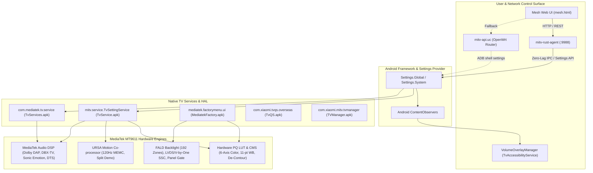

# 📺 Comprehensive Hardware & Engineering Reference: Hidden Mi TV Services & Capabilities

## 🧭 Executive Summary
This document provides an exhaustive technical catalog of all hidden, unexposed, and engineering-level hardware capabilities, picture quality (PQ) calibration tools, motion co-processor (URSA/MEMC) registers, audio DSP engines, and factory diagnostic menus discovered during the reverse engineering of the **Xiaomi Mi TV 75" QLED** (MediaTek MT9611 / M7632 SoC, Android 10 API 29).

Through binary analysis and decompilation of `/system/priv-app/MiTVSettings/MiTVSettings.apk`, `/system/app/TvService/TvService.apk`, `/system/priv-app/TvServices/TvServices.apk`, `/system/product/app/MediatekFactory/MediatekFactory.apk`, and live inspection of the Android `SettingsProvider` and HAL interfaces, we have verified that the underlying television hardware exposes deep engineering controls that are completely hidden or omitted from the stock Android TV GUI menu.

---

## 🏗️ 1. Architecture & Service Ecosystem



### Key APK Packages & Binaries
| Package Name | Binary / APK Path | Purpose |
| :--- | :--- | :--- |
| `com.android.tv.settings` | `/system/priv-app/MiTVSettings/MiTVSettings.apk` | Primary TV settings app. Houses all hidden fragments: `ColorTuneFragment`, `WhiteBalanceCorrection11Fragment`, `MFCCustomActivity`, `DBXFragment`, `SonicEmotionPremiumFragment`, and `FactoryBalanceFragment`. |
| `mitv.service` | `/system/app/TvService/TvService.apk` | Core Xiaomi TV backend daemon. Exposes `mitv.service.TvSettingService`, `PictureSettingsManager`, `SoundManager`, and `ThreeDimensionManager`. |
| `com.mediatek.tv.service` | `/system/priv-app/TvServices/TvServices.apk` | MediaTek proprietary TV HAL service. Manages `AudioCustomizedService`, `AutoFactory`, and `MtkTvFactoryService`. |
| `mediatek.factorymenu.ui` | `/system/product/app/MediatekFactory/MediatekFactory.apk` | Factory and Design engineering menus. Contains `FactoryMenuActivity`, `DesignMenuActivity`, `TestImagePatternsActivity`, and `FactoryUpgradeUrsaFwActivity`. |
| `com.xiaomi.tvqs.overseas` | `/system/priv-app/TvQS/TvQS.apk` | Quick settings overlay and telemetry reporting daemon (`DebugReceiver`, `TvQSReceiver`). |
| `com.xiaomi.mitv.tvmanager` | `/system/priv-app/TVManager/TVManager.apk` | System maintenance and resource manager (`CleanDiskActivity`, `ProcessManagerActivity`). |

---

## 🎨 2. Hidden Picture Quality (PQ) & Video Hardware Engines

The MediaTek MT9611 SoC contains dedicated hardware video pipelines that can be dynamically reconfigured by writing to `Settings.Global`. None of the following controls appear in the stock Android TV settings menu:

### A. 6-Axis CMS Hardware Color Tuner
- **Master Enable Key**: `Settings.Global.tv_picture_color_tune_enable` (`0`=Disabled, `1`=Active)
- **Supported Channels**: Red, Green, Blue, Cyan (spelled `cvan` internally), Magenta (`megenta`), Yellow (`yelloe`), plus **Flesh Tone**.
- **Adjustable Parameters Per Axis** (Values `0` to `100`, Center `50`):
  - `Hue`: `tv_picture_color_tune_hue_<color>`
  - `Saturation`: `tv_picture_color_tune_saturation_<color>`
  - `Brightness`: `tv_picture_color_tune_brightness_<color>`
  - `Gain`: `tv_picture_color_tune_gain_<color>`
  - `Offset`: `tv_picture_color_tune_offset_<color>`
- **Significance**: Allows professional colorimeter calibration (CalMAN / ColourSpace) directly into the MediaTek hardware look-up tables (LUTs) without requiring external video processors.

### B. 11-Point & 20-Point Grayscale White Balance
- **Master Enable Key**: `Settings.Global.picture_white_balance11_enable` (`0`=Disabled, `1`=Active)
- **Calibration Steps**: `picture_white_balance11_gain` (Accepts `5`, `10`, `20`, `30`, `40`, `50`, `60`, `70`, `80`, `90`, `100`% IRE).
- **RGB Bias per IRE Step** (Values `0` to `100`, Center `50`):
  - Red: `picture_white_balance11_red`
  - Green: `picture_white_balance11_green`
  - Blue: `picture_white_balance11_blue`
- **Reset Trigger**: `picture_white_balance11_reset`
- **Significance**: Replaces the coarse Warm/Cool 2-point slider with mastering-grade 11-point IRE grayscale tracking across the entire gamma curve.

### C. De-Contour / Debanding Filter
- **Key**: `Settings.Global.tv_picture_de_contour`
- **Values**: `0` = Off, `1` = Low, `2` = Medium, `3` = High
- **Significance**: Hardware spatial dithering engine that smooths out severe color banding, pixelation steps, and macroblocking in dark film shadows and compressed 8-bit OTT streaming feeds (e.g. Netflix, Prime Video, YouTube).

### D. AI Super Resolution (AI-SR) & AI Picture Quality (AI-PQ)
- **Keys**:
  - `Settings.Global.picture_ai_pq_switch` (`0`=Off, `1`=On)
  - `Settings.Global.tv_picture_ai_sr` (`0`=Off, `1`=On)
- **Significance**: Utilizes the MediaTek APU (AI Processing Unit) to classify video frames in real time (e.g. distinguishing human faces, foliage, blue sky, night sceneries, architecture) and dynamically applies trained neural network upscaling and detail reconstruction.

### E. MaxVivid Dynamic Color Booster
- **Key**: `Settings.Global.tv_picture_video_maxvivid` (`0`=Off, `1`=On)
- **Significance**: MediaTek’s proprietary perceptual saturation expansion algorithm. Unlike crude global saturation bumps that cause human faces to look sunburned, MaxVivid specifically isolates primary colors and non-flesh color vectors to maximize QLED color volume while protecting natural skin tones.

### F. Adaptive Luma & Local Contrast Control
- **Keys**:
  - `Settings.Global.tv_picture_video_adaptive_luma_control` (`0`=Off, `1`=Low, `2`=Medium, `3`=High)
  - `Settings.Global.tv_picture_video_local_contrast_control` (`0`=Off, `1`=Low, `2`=Medium, `3`=High)
- **Significance**: Real-time per-frame tone mapping and local contrast boosting. Works in tandem with the 192-zone Full Array Local Dimming (FALD) backlight to elevate peak specular highlights while preserving deep blacks in high-contrast scenes.

### G. HDMI True RGB Quantization Range Override
- **Key**: `Settings.Global.tv_picture_video_hdmi_rgb_range`
- **Values**: `0` = Auto, `1` = Full (0–255), `2` = Limited (16–235)
- **Significance**: Eliminates HDMI handshake mismatches. When connecting PCs, MacBooks, or gaming consoles, forcing `1` (Full RGB) prevents crushed shadow detail and washed-out grey blacks.

### H. Color Space Forcing
- **Key**: `Settings.Global.tv_picture_advanced_video_color_space`
- **Values**: `0` = Auto, `1` = Rec.709 (sRGB), `2` = DCI-P3 (Wide Gamut), `3` = BT.2020
- **Significance**: Allows overriding the broadcast gamut metadata, enabling native DCI-P3 wide color gamut mapping on standard dynamic range (SDR) content.

---

## 🏎️ 3. Motion Interpolation & MEMC (URSA Co-processor) Tools

The Mi QLED TV 75" features a dedicated **URSA motion co-processor** driving its 120Hz panel.

### A. Split-Screen MEMC Live Comparison Demo
- **Key**: `Settings.Global.tv_picture_video_mjc_demo_partition`
- **Values**: `0` = Off, `1` = Left/Right Split-Screen
- **Significance**: Splits the physical 75" screen down the exact center:
  - **Left Half**: Displays raw native cadence (24p film or 60p broadcast without interpolation).
  - **Right Half**: Displays active 120Hz MEMC motion interpolation with judder reduction in real time.
- **Activity**: `com.android.tv.settings.partnercustomizer.picture.MJCActivity`

### B. Discrete De-Judder & De-Blur Sliders (MFC Custom)
- **Keys**:
  - `Settings.Global.tv_picture_mfc_smooth` (Range: `0` to `10`) — Controls 24p/30p film cadence de-judder.
  - `Settings.Global.tv_picture_mfc_clear` (Range: `0` to `10`) — Controls 60p high-motion de-blur / backlight strobing.
- **Activity**: `com.android.tv.settings.partnercustomizer.picture.MFCCustomActivity`
- **Significance**: Allows users to eliminate film judder without introducing the unwanted "soap opera effect" or motion halo artifacts.

---

## 🔊 4. Hidden Audio DSP Suites & Spatial Sound Engines

> ### ⚠️ VERIFICATION STATUS (measured on-device 2026-10-18) — read before using anything below
>
> **Everything in this section was originally extracted from decompiled `MiTVSettings.apk`
> strings. That lists every key the settings *app* knows about, not every key this *firmware*
> honours.** Each candidate has now been toggled on the live TV and checked for an
> `TVSettingConfig: setConfigValue is configId …` line in logcat. Most of this section's keys
> turn out to be inert.
>
> | Key | MediaTek config ID | Status |
> |---|---|---|
> | `sound_dts_virtual_x` | `g_audio__dts_virtual_x` | ✅ **REAL** |
> | `dts_virtual_surround` | `g_audio__dts_surround` | ✅ **REAL** |
> | `dts_dialog_clarity` | `g_audio__dts_limiter` | ✅ **REAL** (name and register disagree) |
> | `dts_bass_enhancement` | `g_audio__dts_tbhdx` | ✅ **REAL** (this is TruBass HDX) |
> | `sound_dts_drc` | `g_fusion_sound__dts_drc` | ✅ **REAL** |
> | `sound_dts_tbhdx`, `sound_dts_limiter` | — | ❌ **INERT** — §C2/C3 below name these; the live aliases are the two `dts_*` keys above |
> | all `sound_dbx_*` (§A) | — | ❌ **INERT** |
> | `sound_sonic_emotion_premium` (§B) | — | ❌ **INERT** |
> | all `sound_dts_studio_*` (§C3) | — | ❌ **INERT** |
> | `sound_downmixmode` (§D) | — | ❌ **INERT** |
> | `sound_equalizer_detail_600hz`, `…_12000hz` (§C4) | — | ❌ **INERT** — the EQ is **5-band**, not 7 |
>
> **Methodology note — do not repeat this mistake.** `logcat -c` does **not** clear the kernel
> ring buffer, so stale `[SGLUE_AUD]` lines from a previous toggle reappear on the next read
> and register as a hit. That produced a confident but wrong "DBX is real" result before the
> method was corrected. Count only the Android-side `TVSettingConfig` marker.
>
> A fragment class existing in the APK proves only that Xiaomi shipped one settings binary
> across several panel/SoC variants — not that this panel has the licensed DSP block behind it.

While the TV GUI displays a simple "Dolby Atmos" toggle, the MediaTek audio HAL contains full professional DSP suites:

### A. DBX-TV Professional Audio Enhancement Suite
> ❌ **INERT on this firmware.** Writing any `sound_dbx_*` key produces no `TVSettingConfig`
> reaction and no HAL activity. Catalogued for completeness; do not wire it into anything.
- **Keys**:
  - `Settings.Global.sound_dbx_enable` (`0`=Off, `1`=On)
  - `Settings.Global.sound_dbx_total_sonic` (Psychoacoustic bass extension & high-frequency harmonic exciter)
  - `Settings.Global.sound_dbx_total_surround` (Phase-matrix spatial widening)
  - `Settings.Global.sound_dbx_total_vol` (Dynamic acoustic range leveling)
- **Fragment**: `com.android.tv.settings.partnercustomizer.sound.dbx.DBXFragment`

### B. Sonic Emotion 3D Soundfield Synthesis
> ❌ **INERT on this firmware** — no HAL reaction when toggled.
- **Key**: `Settings.Global.sound_sonic_emotion_premium` (`0`=Off, `1`=On)
- **Fragment**: `com.android.tv.settings.partnercustomizer.sound.sonic_emotion_premium.SonicEmotionPremiumFragment`
- **Significance**: Pure algorithmic soundfield synthesis designed to virtualize 3D height and wider acoustic immersion.

### C. DTS (Digital Theater Systems) Hardware Decoders & Multi-Suite DSPs

The MediaTek MT9611 platform contains licensed native DTS silicon decoding, post-processing DSP suites, and bitstream pass-through pipelines:

#### 1. Hardware Silicon Audio Decoders (`OMX.MS.DTS.Decoder`)
Verified via `dumpsys media.player` and `/vendor/etc/audio_policy_configuration.xml`:
- **DTS Digital Surround (Core 5.1 / 96/24)**: Hardware decoding of `audio/vnd.dts` up to 5.1 discrete channels at 48 kHz / 96 kHz, 24-bit depth.
- **DTS-HD Master Audio & High Resolution**: Lossless decoding of `audio/vnd.dts.hd` supporting up to **7.1 discrete channels** at sampling rates up to **192 kHz**.
- **DTS Express (Low Bit Rate / LBR)**: Decoding of `audio/vnd.dts.hd;profile=lbr` for secondary streaming audio, director commentary, and interactive broadcasting.
- **Bitstream Raw Passthrough (`dts raw`)**: Passthrough over **HDMI eARC** and **Optical SPDIF** without downmixing to PCM.

#### 2. DTS Virtual:X 3D Immersive Audio Suite
> ✅ **REAL — this is the one spatial engine that actually works on this panel**, and the only
> way to get any height/surround illusion out of the TV's own speakers. Note it only does
> anything on the **internal-speaker path**: over HDMI-ARC the bitstream is passed through
> untouched and every TV-side post-processor is bypassed. Applied automatically by
> `mitv-api?cmd=audio_profile&param=tv`. See `AUDIO.md`.
Extracted from `com.android.tv.settings.partnercustomizer.sound.dts.DTSFragment` and `DtsCustomFragment`:
- **Master Enable**: `Settings.Global.sound_dts_virtual_x` (`0`=Off, `1`=On)
- **DTS Virtual Surround**: `Settings.Global.dts_virtual_surround` (`0`=Off, `1`=On) — Synthesizes virtual 3D height channels and spatial side envelope.
- **DTS Dialog Clarity**: `Settings.Global.dts_dialog_clarity` (`0`=Off, `1`=On) — Center-channel vocal extraction and speech intelligibility enhancement.
- **DTS Bass Enhancement / TruBass HDX**: `Settings.Global.dts_bass_enhancement` / `sound_dts_tbhdx` (`0`=Off, `1`=On) — Psychoacoustic low-frequency harmonic exciter.
- **DTS Multi-Band Limiter**: `Settings.Global.sound_dts_limiter` (`0`=Off, `1`=On) — Hardware brickwall limiter to eliminate voice coil clipping at high volume.

#### 3. DTS-StudioSound 2 Suite
> ❌ **INERT on this firmware** — none of the `sound_dts_studio_*` keys reach the DSP.
Extracted from `com.android.tv.settings.partnercustomizer.sound.dts_studio.DTS_StudioSoundFragment`:
- **StudioSound Master Toggle**: `Settings.Global.sound_dts_studio_enable` (`0`=Off, `1`=On)
- **Studio Surround**: `Settings.Global.sound_dts_studio_surround` (`0`=Off, `1`=On) — Phase-matrix soundstage expansion.
- **DTS TruVolume HD**: `Settings.Global.sound_dts_studio_truevolume` (`0`=Off, `1`=On) — Multi-band acoustic volume leveler that prevents loud commercial spikes.

#### 4. 7-Band DTS Graphic Equalizer
> ⚠️ **It is a 5-band EQ in practice.** `sound_equalizer_detail_600hz` and `…_12000hz` read
> `null` and are inert; only 100 Hz / 250 Hz / 1 kHz / 2.5 kHz / 6 kHz respond. The bands are
> also **sticky across sound-profile switches** — a Dialogue-Clarity curve was found still
> applied under an active Theater profile — which is why `mitv-api`'s `audio_profile` handler
> writes all five explicitly every time.
Extracted from `com.android.tv.settings.mitv.sound.DtsEqualizerFragment`:
- Directly mapped to MediaTek DSP registers `g_audio__aud_eq_band_1` through `band_7`:
  - `sound_equalizer_detail_100hz`: Sub-bass rumble (100 Hz)
  - `sound_equalizer_detail_250hz`: Mid-bass impact (250 Hz)
  - `sound_equalizer_detail_600hz`: Lower midrange warmth (600 Hz)
  - `sound_equalizer_detail_1000hz`: Vocal body and presence (1 kHz)
  - `sound_equalizer_detail_2500hz`: Dialogue clarity and consonants (2.5 kHz)
  - `sound_equalizer_detail_6000hz`: Treble presence (6 kHz)
  - `sound_equalizer_detail_12000hz`: Air and high-frequency sparkle (12 kHz)

#### 5. DTS Dynamic Range Control (DRC)
> ✅ **REAL** — `sound_dts_drc` maps to `g_fusion_sound__dts_drc`, confirmed live.
- **Setting Keys**: `Settings.Global.sound_dts_drc` / `device_sound_dts_drc`
- **Audio Flinger Parameter**: `- DTS DRC scale`
- **Function**: Dynamic range compressor for late-night viewing.

#### 6. Note on DST (Direct Stream Transfer)
- In the HDMI Audio Flinger dump (`[HDMIARC][DST] support: 0`), **DST** refers to **Direct Stream Transfer**, the lossless compression format used for multichannel Super Audio CD (SACD) DSD bitstreams over HDMI.

#### 7. Why DTS Menus Are Hidden in Stock Android TV UI
- When HDMI ARC/eARC is set as the active audio sink (`sound_output_switch = 5`), the stock TV UI hides the DTS Virtual:X and DTS StudioSound sub-menus under the assumption that external soundbars handle audio decoding. All settings can be activated independently via ADB (`settings put global ...`) or via `mitv-api.uc`.

### D. Audio Downmixing Matrix Mode
> ❌ **INERT on this firmware** — `sound_downmixmode` reads `null` and produces no HAL reaction.
- **Key**: `Settings.Global.sound_downmixmode`
- **Values**:
  - `0` = **Lo/Ro Stereo** (Standard left/right downmix for stereo headsets/speakers)
  - `1` = **Lt/Rt Pro Logic Matrix** (Surround-encoded matrix downmix for legacy surround decoders)

### E. Microsecond Hardware Audio Lip-Sync Calibration
> ✅ `sound_spdif_delay` is real and is set to **70 ms** by the `sony` audio profile. Note the
> reference to **eARC** below is wrong: `dumpsys hdmi_control` reports `mEarcConnected: false`,
> so this link is **plain ARC**. `sound_speaker_delay` reads `null` (inert).
- **Keys**:
  - `Settings.Global.sound_spdif_delay` (0 to 250 ms)
  - `Settings.Global.sound_speaker_delay` (0 to 250 ms)
- **Significance**: Hardware-level delay register calibrated to compensate for HDMI eARC signal processing latency between the MediaTek SoC and external soundbars (Sony HT-S40R).

---

## ⚡ 5. Power, Panel Health & Diagnostics

### A. Panel-Off / Audio-Only Streaming Mode
- **Key**: `Settings.Global.power_picture_off = 1`
- **Mechanism**: Completely powers down the 75" QLED Full-Array Local Dimming LED array and turns off the panel gate drivers, while the MediaTek audio DSP, Android OS, and HDMI-CEC / eARC output remain fully powered and active.
- **Practical Application**: Turns the TV into an ultra-low-power headless music streamer when playing Spotify, Apple Music, or radio apps through the Sony HT-S40R 5.1ch soundbar.

### B. Hardware Cumulative Panel Runtime Hours
- **Key**: `Settings.System.panel_display_time`
- **Verified Value**: **`7519` hours**
- **Mechanism**: Hardware counter incremented in non-volatile storage by the display controller whenever the panel backlight is energized.

### C. OLED/QLED Thermal & Peak Luminance Protection (TPC/CPC/LEA)
- **Source**: `res/xml/oled_debug.xml`
- **Keys**:
  - `tpc` (Temporal Peak Luminance Control): Automatically dims static screen elements (logos, scoreboards) to prevent heat build-up.
  - `cpc` (Convex Power Control): Limits overall average picture level (APL) power draw.
  - `lea` (Low Energy Adaptation): Optimizes LED power rails.
  - `current_temperature`: Live internal thermal sensor reading.

---

## 🔬 6. MediaTek Factory & Design Engineering Menus

The TV firmware includes two complete engineering menus packaged inside `/system/product/app/MediatekFactory/MediatekFactory.apk`:

### A. Hardware Factory Menu
- **Launch Command**:
  ```bash
  adb shell am start -a mediatek.tvsetting.factory.intent.action.FactorymenuActivity
  ```
- **Engineering Submenus**:
  1. **ADC Adjust (`ADCAdjustViewHolder`)**: Hardware register calibration for analog RGB gain, offset, and phase.
  2. **OverScan Adjust (`OverScanAdjustViewHolder`)**: Hardware raster sizing (H-Size, V-Size, H-Pos, V-Pos).
  3. **White Balance Hardware Registers (`WBAdjustViewHolder`)**: Direct register trimming for the display controller.
  4. **Other Options (`OtherOptionForFactory`)**:
     - Power-On Behavior: `Direct On` (turns on automatically after power cut), `Standby`, or `Last State Memory`.
     - Panel Burn-in & Aging Mode: Full-screen cycling RGB rasters.
     - UART to HDMI port routing.

### B. MediaTek Design Menu
- **Launch Command**:
  ```bash
  adb shell am start -a mediatek.tvsetting.factory.intent.action.MainmenuActivity
  ```
- **Engineering Submenus**:
  1. **Spread Spectrum Clocking (`SSC Adjust`, `res/layout/sscadjust.xml`)**:
     - Controls LVDS / V-by-One high-speed video bus clock modulation percentage and frequency dithering to suppress electromagnetic interference (EMI) that can degrade nearby 2.4GHz/5GHz Wi-Fi and Bluetooth antennas.
  2. **Factory PQ Binary Update (`FactoryPqUpdateActivity`)**:
     - Allows flashing updated binary picture quality lookup tables directly from USB into the MediaTek video scaler.
  3. **URSA Motion Co-processor Firmware Upgrade (`FactoryUpgradeUrsaFwActivity`)**:
     - Direct firmware flashing and diagnostics for the 120Hz motion interpolation processor.
  4. **Panel Test Pattern Generator (`TestImagePatternsActivity`)**:
     - Generates full-screen pure RGB rasters, 16-step IRE grayscale ramps, and checkerboards for dead pixel, clouding, and uniformity inspection.
  5. **Hardware DRM & Attestation Key Status (`FactoryInfoFragment`)**:
     - Real-time hardware verification of HDCP 1.4, HDCP 2.2, Widevine L1, Microsoft PlayReady, CI+, and Netflix MGKID security keys.

---

## 💻 7. Programmatic Integration Matrix

All discovered parameters can be manipulated instantly without touching the TV remote via three distinct integration channels:

| Control Target | Fast Direct ADB Command | Native Rust Agent Hook (`:9988`) | OpenWrt Router Bridge (`mitv-api.uc`) |
| :--- | :--- | :--- | :--- |
| **Panel Off (Audio Only)** | `settings put global power_picture_off 1` | `GET /panel_off` | `cmd=panel_off` |
| **MEMC Split Demo** | `settings put global tv_picture_video_mjc_demo_partition 1` | `GET /memc_demo?enable=1` | `cmd=memc_demo&param=1` |
| **De-Contour Filter** | `settings put global tv_picture_de_contour 2` | `GET /de_contour?level=2` | `cmd=de_contour&param=2` |
| **Full RGB (0–255)** | `settings put global tv_picture_video_hdmi_rgb_range 1` | `GET /rgb_range?range=full` | `cmd=rgb_range&param=full` |
| **AI Picture Quality** | `settings put global picture_ai_pq_switch 1` | `GET /ai_pq?enable=1` | `cmd=ai_pq&param=1` |
| **MaxVivid Color** | `settings put global tv_picture_video_maxvivid 1` | `GET /maxvivid?enable=1` | `cmd=maxvivid&param=1` |
| **Factory Menu** | `am start -a mediatek.tvsetting.factory.intent.action.FactorymenuActivity` | `GET /launch_factory` | `cmd=launch_factory` |
| **Panel Test Pattern** | `am start -n mediatek.factorymenu.ui/...TestImagePatternsActivity` | `GET /test_patterns` | `cmd=test_patterns` |
| **Read Panel Hours** | `settings get system panel_display_time` | `GET /state` (reports `panel_hours`) | `cmd=display_state` |
